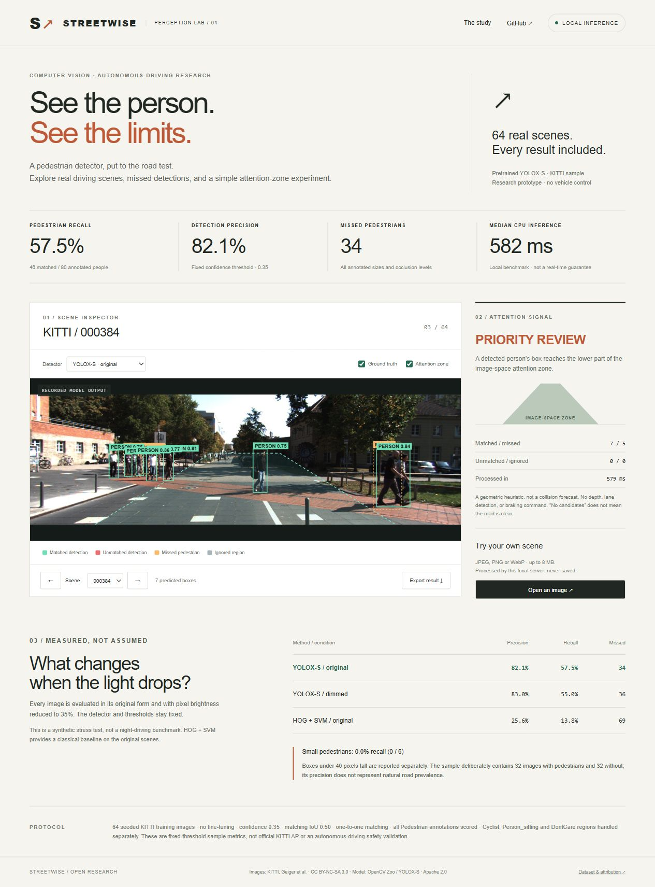

# Streetwise · Pedestrian Perception Lab

Human detection in real autonomous-driving camera images, with an honest view of misses. A pretrained YOLOX-S detector is compared with OpenCV's classical HOG + SVM pedestrian detector on a reproducible 64-image KITTI sample. A local dashboard exposes every evaluated scene, original/dimmed conditions, annotations, false positives, misses, and a simple image-space attention rule.



## Measured results

Frozen confidence 0.35, NMS IoU 0.45, matching IoU 0.50. All 80 annotated Pedestrian boxes are scored, including small, truncated and occluded people.

| Method | Precision | Recall | Matched / missed | Median CPU time |
|---|---:|---:|---:|---:|
| YOLOX-S, original | 82.1% | 57.5% | 46 / 34 | 582 ms |
| YOLOX-S, brightness ×0.35 | 83.0% | 55.0% | 44 / 36 | 582 ms |
| HOG + SVM, original | 25.6% | 13.8% | 11 / 69 | 140 ms |

YOLOX missed all six pedestrians under 40 pixels tall and found 8 of 29 occluded pedestrians. Its measured CPU speed is **not real-time driving performance**. The dim condition is a synthetic pixel-intensity perturbation, not a night-driving dataset. This is a small sample study, not official KITTI AP, a new trained model, or a vehicle-ready safety system.

## Run locally

Python 3.11+:

```sh
python -m venv .venv
# Windows: .venv\Scripts\activate
# macOS/Linux: source .venv/bin/activate
python -m pip install -r requirements-lock.txt
python -m pip install --no-deps -e .
python -m pedestrian_lab.cli serve
```

Open **http://127.0.0.1:8783/**. The committed results and JPEG previews work without downloading the model. Choose any scene or method; toggle annotations and the attention zone; export a scene's JSON.

For new local image inference, download the checksum-pinned 35.9 MB model:

```sh
python scripts/setup.py
python -m pedestrian_lab.cli detect path/to/street.jpg --output detections.json
```

The dashboard's **Open an image** button uses the same detector on the local server. Images are not sent to a cloud service or saved. JPEG/PNG/WebP, 8 MB maximum, dimensions 32–4096 pixels. Output files from the CLI use exclusive creation to avoid overwriting existing results.

## Reproduce the study

```sh
python -m pedestrian_lab.cli prepare --data data/kitti
python -m pedestrian_lab.cli evaluate --data data/kitti --output reports/custom
python -m unittest discover -s tests -v
```

Preparation uses byte-range requests to obtain only the selected PNGs from the official 12 GB KITTI archive. It freezes scene IDs before inference, records checksums, and rejects servers that ignore Range requests. The sample uses Python's seeded random selection (20261018): 32 images containing Pedestrian labels and 32 without. This changes class prevalence; sample precision must not be interpreted as a deployment precision estimate. Nearby KITTI frames may be correlated. No train/validation split or fine-tuning is performed, and thresholds are not selected using these results.

Predictions are matched by decreasing confidence to unused ground-truth pedestrians at IoU ≥0.5. Unmatched predictions may be ignored for Cyclist/Person_sitting overlap or DontCare regions; duplicate pedestrian detections remain false positives. Unlike official KITTI difficulty/AP scoring, this study scores every Pedestrian box and reports one fixed threshold. HOG uses its default pretrained people detector and default detection threshold. Its scores are SVM margins, not probabilities.

`reports/results.json` contains all scene-level outputs, matching decisions, annotations, subgroup results, timings, image/model checksums and the evaluated source hashes. JPEGs are compressed display derivatives; inference used the original PNGs. The initial dashboard scene is the first sampled scene containing a Pedestrian annotation, not the best-performing scene.

## Attention rule and scope

The bottom center of a detected box is compared with a fixed trapezoid. A lower-zone box yields **PRIORITY REVIEW**, an upper-zone box **WATCH ZONE**. These are visual research signals. No lane detection, depth estimation, time-to-collision, tracking, sensor fusion, planning, braking or steering is implemented. **NO CANDIDATES does not mean the road is safe.** Warning-zone correctness was tested geometrically, not validated against collision outcomes.

See [VALIDATION.md](VALIDATION.md) for tests and browser checks, and [ATTRIBUTION.md](ATTRIBUTION.md) for licensing. Original implementation and testing were AI-assisted. Dataset-derived images/annotations are noncommercial share-alike material; see the separate licenses before reuse.
